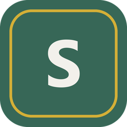
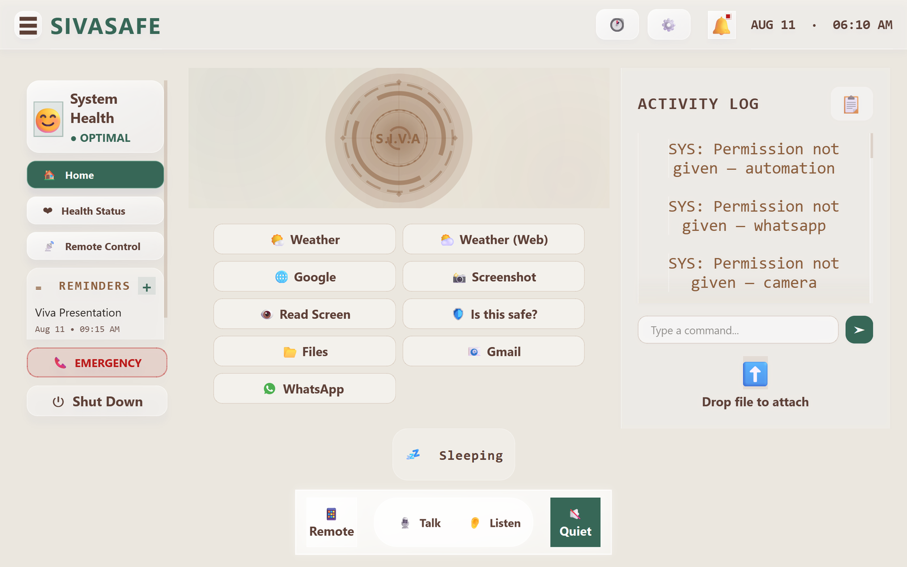
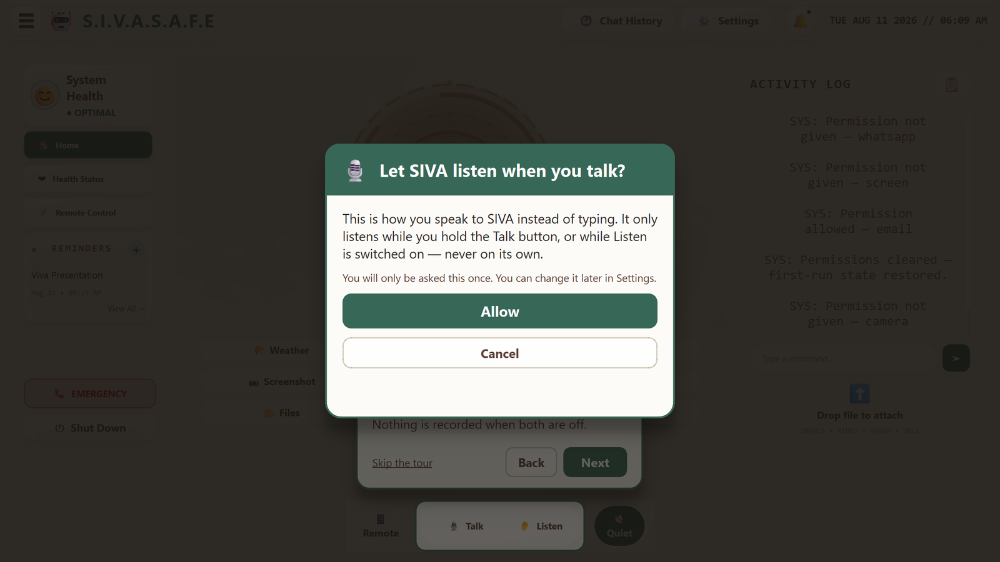
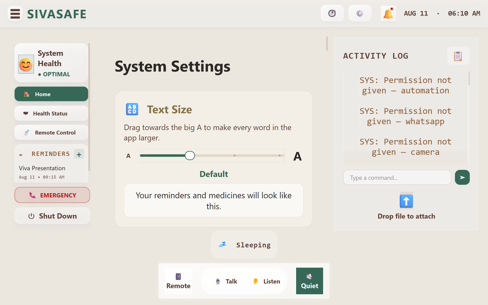
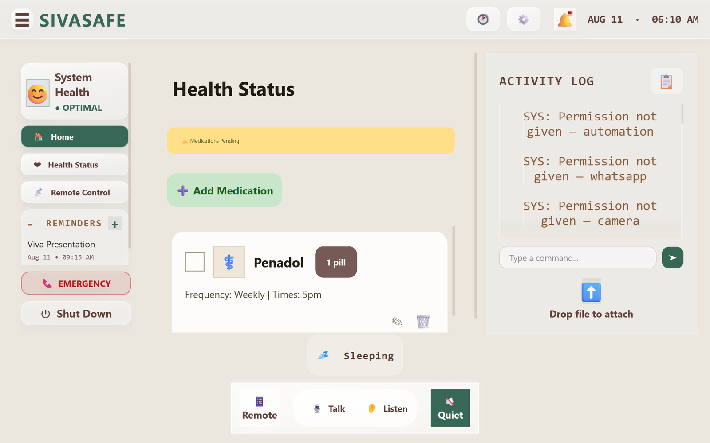
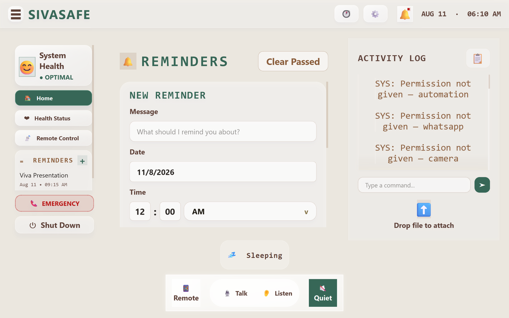
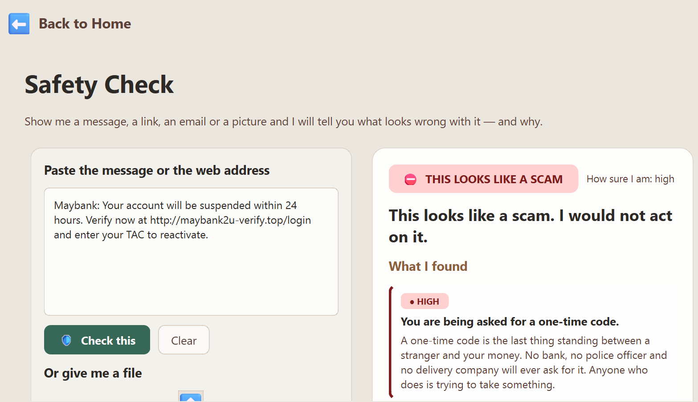
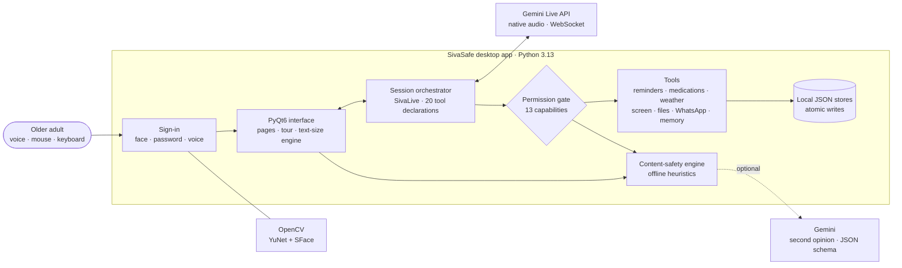

<div align="center">



# SivaSafe

**Smart Interactive Virtual Aide for Senior Accessibility, Functionality & Engagement**

A voice-first desktop companion that helps older adults use their computer safely and independently.<br>
Talk to it. It reminds, reads, explains and checks suspicious messages, and it always asks before it acts.

[](https://www.python.org/)
[](https://pypi.org/project/PyQt6/)
[](https://ai.google.dev/gemini-api/docs/live)
[](https://opencv.org/)
[](https://fastapi.tiangolo.com/)
[](#getting-started)
[](LICENSE)
[](#academic-context)

[Features](#features) · [Screenshots](#screenshots) · [Architecture](#architecture) · [Engineering highlights](#engineering-highlights) · [Getting started](#getting-started) · [Testing](#testing)



</div>

---

## Why SivaSafe?

Most software assumes good eyesight, steady hands, comfort with technical language and a sharp eye for scams. Many older adults can't rely on any of those, and they are frequent targets of fraud.

SivaSafe is a desktop companion built around them. You simply talk to it. It keeps track of medicines and appointments, explains what's on the screen, and checks a suspicious message *before* you act on it. It never does anything on your behalf without first asking, in plain words.

## Features

| | |
|---|---|
| 🎙️ **Natural voice conversation** | Real-time, two-way speech with **Gemini 2.5 Flash (native audio)** over the Live API. Hold **Talk**, or switch on hands-free **Listen**. It never listens on its own. |
| 🛡️ **"Is this safe?" scam and AI-content check** | Paste a message, link, email (`.eml`) or picture and get a plain-English verdict with the reasons behind it. Tuned for Malaysian scam patterns such as TAC/OTP requests, "Macau scam" threats and bank look-alike domains. **Works fully offline**, with Gemini as an optional second opinion. |
| 🔐 **Face, password or voice sign-in** | On-device face recognition (OpenCV **YuNet + SFace**) with a two-blink liveness check against photo spoofing, a password you can type *or say* (transcribed offline by faster-whisper), lockout after repeated failures, and password recovery by email. |
| ✅ **Plain-language permissions** | 13 capabilities (camera, microphone, WhatsApp, screen and more), each asked for **once**, in words that say what SIVA will *and won't* do. |
| 🧭 **Guided first-run tour** | A 12-step walkthrough that highlights each real control and explains what it does. |
| 🔠 **Adjustable text size** | One slider scales every word in the app, sign-in screen included, across 5 sizes, with **no horizontal scrolling** at any size. |
| 💊 **Reminders, tasks and medications** | Set reminders by voice or on screen. Medicines track dose, frequency and times. |
| 🧠 **Long-term memory** | Remembers preferences and context across sessions, with permission. |
| 🛟 **Built to run all day** | A crash guard, atomic saves, a clean one-click shutdown, and automatic API-key failover when a free-tier quota runs out. |
| 🧰 **Everyday helpers** | Weather, web search, reading and explaining what's on screen, WhatsApp, files, and an always-visible **Emergency** button. |

## Screenshots

<table>
  <tr>
    <td width="50%"><br><sub><b>Guided tour and plain-language permissions.</b> Each capability is explained and asked for once.</sub></td>
    <td width="50%"><br><sub><b>Text size.</b> One slider rescales the whole interface.</sub></td>
  </tr>
  <tr>
    <td width="50%"><br><sub><b>Health status.</b> Medications with dose, frequency and times.</sub></td>
    <td width="50%"><br><sub><b>Reminders.</b> Large, simple forms. Reminders can also be set by voice.</sub></td>
  </tr>
</table>

### The safety check



Here a fake bank message asking for a TAC code is flagged as a scam, and the reader is told the reason that matters. Every finding also says what it does **not** prove, and every verdict ends with a reminder that it is a guide, not a guarantee.

## Architecture



- **One reasoning core.** A single live Gemini session handles the conversation and decides when to call one of 20 declared tools. Tool calls that touch the camera, microphone, screen, apps or personal data pass through the permission gate first.
- **The interface never waits on the network.** The live session, tools and network calls run off the GUI thread and report back to the interface through queued Qt signals.
- **Personal data is stored locally.** Reminders, medications, memory, permissions and the face template live on the machine as JSON and are never committed to this repository. Conversation audio is processed by the Gemini API.

### Tech stack

| Layer | Technology |
|---|---|
| Interface | PyQt6: custom widgets, animations, and an app-wide event filter for text scaling |
| Conversation | Google **Gemini 2.5 Flash native audio** via the `google-genai` Live API · `sounddevice` (PortAudio) |
| Sign-in | OpenCV **YuNet** face detector + **SFace** recogniser (bundled ONNX models), with a stricter match threshold than OpenCV's default (cosine 0.65 vs 0.363) · two-blink liveness · offline **faster-whisper** for the spoken password |
| Safety check | Pure-Python heuristic engine · Gemini structured output (JSON schema, temperature 0) |
| Automation | PyAutoGUI · Playwright · mss · pywin32 |
| Caregiver dashboard | FastAPI + Uvicorn over HTTPS · `cryptography` · QR pairing |
| Launcher | Native C# stub compiled with the Windows-bundled `csc.exe` |

## Engineering highlights

Some of the more interesting problems solved along the way:

- **App-wide text scaling without editing ~180 call sites.** Font sizes were hard-coded across the UI in two different units, points and pixels. Instead of editing each one, a `QApplication`-wide event filter rescales every widget as it is polished or shown. It works at **three rates**: text at 100%, chrome at 30% and panel widths at 50%, so buttons don't balloon as the text grows. Profiling showed that 460 ms of a 522 ms resize was a redundant global stylesheet re-polish. Removing it brought a size change down to **~140 ms**.
- **A scam checker whose offline engine is the product.** The deterministic layer checks URLs (punycode and homographs, brand look-alikes by Levenshtein distance against ~45 Malaysian and global brands, risky TLDs, shorteners). It also checks wording across 10 scam categories, `.eml` authentication (SPF/DKIM/DMARC, Reply-To mismatches) and image metadata (AI-generator tags, C2PA). Gemini's opinion is fused **asymmetrically**, as `max(offline, min(ai, offline + 1))`. The model can raise a verdict by one step but can never lower it, so a hallucination can't hide a real scam.
- **Permissions designed for the person, not the developer.** *Allow is stored; Cancel is not.* One mis-click should never silently disable WhatsApp for someone who won't go hunting through Settings. Permission checks deliberately **fail open**, while the sign-in lock **fails closed**: opposite defaults for opposite risks.
- **API-key failover that actually fires.** The Live API runs over a WebSocket, so quota exhaustion arrives as a *close code* wrapped in nested `ExceptionGroup`s, never as HTTP 429. The original check therefore never matched. A shared detector now unwraps the exception chain and matches the server's own wording. A key rotator then walks primary → secondary → tertiary and resets after a successful connection.
- **Built to run all day on someone's PC.** Uncaught exceptions are logged instead of aborting the Qt process. Every store is written via temp file → `fsync` → atomic replace (+3.7 ms per save), so a hard kill can't corrupt data. Shutdown uses `TerminateProcess` because `os._exit` hung while unwinding PortAudio, Uvicorn and asyncio threads. The window now closes in about 200 ms.

### Measured results

| Measure | Result |
|---|---|
| Gemini 2.5 Flash API response, short conversational prompt (5 trials) | **1.15 s** median |
| Gemini 2.5 Flash API response, tool-parameter extraction (5 trials) | **1.16 s** mean |
| Benchmark requests completed | **15 / 15** |
| Text-size change, GUI blocking time | **522 ms → ~140 ms** |
| Horizontal overflow, every page and overlay at every text size | **0** |
| WCAG 2.2 contrast audit, 15 key elements | **14 pass AA**, 9 of them AAA |
| Atomic-save overhead | **+3.7 ms** per write |

The API timings are text requests to `gemini-2.5-flash`, measured from Python. They show the model's own response time, not the full spoken round trip, which also includes listening and speech.

## Getting started

### Requirements

- Windows 10 or 11
- Python 3.13
- A webcam and a microphone
- A free Gemini API key from [Google AI Studio](https://aistudio.google.com/apikey)

### Install and run

```powershell
git clone https://github.com/Thaneerrjun7/SivaSafe-Elderly-Accessibility-Program-.git
cd SivaSafe-Elderly-Accessibility-Program-
python -m venv .venv
.venv\Scripts\activate
pip install -r requirements.txt
playwright install
python main.py
```

On first launch SivaSafe asks for your Gemini API key. It then runs the guided tour, which explains each control and asks for permissions as they come up. It also checks for missing packages and installs any that its chosen speech engines need.

### Optional configuration

Settings live in `config/api_keys.json`, which is git-ignored. To set them by hand, copy [`config/api_keys.example.json`](config/api_keys.example.json) to `config/api_keys.json`:

| Key | Purpose |
|---|---|
| `gemini_api_key` | **Required.** The main conversation key |
| `gemini_api_key_secondary`, `gemini_api_key_tertiary` | Automatic failover when a free-tier quota (5 requests per minute) runs out |
| `google_search_api_key`, `google_search_cx` | Web search through Google Custom Search |
| `smtp_sender`, `smtp_app_password` | Sending password-recovery emails |

For a double-click desktop app with no terminal window, run `launcher\build.ps1`. It compiles a small native `SivaSafe.exe` launcher with the C# compiler that ships with Windows and adds a desktop shortcut.

## Testing

`devtools/` holds diagnostic harnesses that drive the **real** interface. Where needed they stub the webcam and use a temporary home directory, so they never touch your data. Run them from the project root, for example `python devtools\safety_selftest.py`.

| Harness | What it proves | Result |
|---|---|---|
| `safety_selftest.py` | 8 text, 4 image and 3 URL cases, including a genuine bank notice that must *not* be flagged | **15/15** |
| `safety_wiring_test.py` | Every route into the safety check, including cross-thread rendering | **16/16** |
| `permission_test.py` | Every gate consults the store, Allow is saved and Cancel isn't, and the live gate never stalls the session | **60/60** |
| `quota_rotation_test.py` | Quota detection and key rotation against the SDK's real exception shapes | **10/10 · 5/5** |
| `tour_render.py` | All 12 tour steps × 2 window sizes × 2 text sizes | **Pass** |
| `layout_audit.py` | 4 window sizes × 4 text sizes × every page and overlay | **0** sideways scroll |
| `hover_test.py` | Every animated button at all 5 text sizes | **No crashes** |
| `shutdown_test.py` | A clean exit, and every data store surviving a hard kill | **Pass** |

## Project structure

```
├── main.py            Entry point · Gemini Live session · tool registry
├── ui.py              PyQt6 interface: every page, overlay and the guided tour
├── core/              Sign-in, permissions, text scaling, crash guard, safe storage, key rotation
├── actions/           The assistant's tools: reminders, medications, weather, content safety …
├── dashboard/         Caregiver web dashboard (FastAPI, HTTPS)
├── memory/            Long-term memory
├── config/            Settings loader and the bundled face-recognition models
├── launcher/          Native Windows launcher (C#) and its build script
├── devtools/          Diagnostic harnesses: layout, permissions, safety, shutdown …
├── tests/             Command-routing evaluation harness
├── scripts/           Asset generators and utilities
├── assets/            Icons
└── docs/screenshots/  Images used in this README
```

## Roadmap

- **Caregiver remote access.** The HTTPS dashboard and QR pairing are built; the phone-side flow is in progress.
- **High-contrast mode.** The preference store is already designed to hold it.
- **Cancelling and completing reminders by voice.**
- **Live threat-intelligence feeds for the safety check.** Site reputation currently uses deterministic domain heuristics, and image checks read file metadata rather than analysing pixels.

## Academic context

SivaSafe was built solo over two semesters, about five to seven months in total, as the **Final Year Project** for a **Bachelor of Software Engineering (Honours)**, a dual degree from **Lancaster University** and **Sunway University**. It was awarded an **A**. The project covered requirements, design, implementation and evaluation, the last through latency benchmarks, a WCAG 2.2 contrast audit and heuristic evaluation.

## Acknowledgements

- SivaSafe started from **[MARK XLVI](https://github.com/FatihMakes/Mark-XLVI)** by FatihMakes, an open-source Gemini voice assistant, used under CC BY-NC 4.0. SivaSafe builds on it with:
  - a senior-focused interface and sign-in
  - the accessibility and text-scaling engine
  - the content-safety checker
  - the permission system and guided tour
  - the reliability work and the test harnesses
- Face models: [YuNet and SFace](https://github.com/opencv/opencv_zoo) from the OpenCV Model Zoo.
- Conversation and second opinions: the [Google Gemini API](https://ai.google.dev/).

## License

SivaSafe is shared under **[Creative Commons Attribution-NonCommercial 4.0](https://creativecommons.org/licenses/by-nc/4.0/)**, the same license as the project it builds on. You may use and adapt it for non-commercial purposes, with attribution. See [LICENSE](LICENSE).

## Author

**Arjun Shanker**, Bachelor of Software Engineering (Hons), dual degree from Lancaster University and Sunway University<br>
Portfolio: [thaneerrjun7.github.io/Arjun-Portfolio](https://thaneerrjun7.github.io/Arjun-Portfolio/) · GitHub: [@Thaneerrjun7](https://github.com/Thaneerrjun7)
